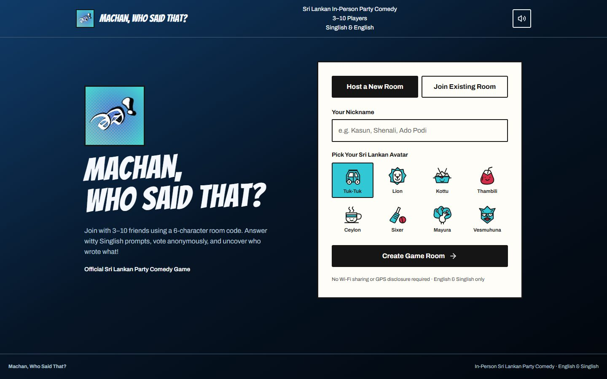

<div align="center">
  
  <h1>Machan, Who Said That?</h1>
  <p><strong>Write something funny. Vote anonymously. Find out which machan said it.</strong></p>
  <p>A Sri Lankan party game in English and Singlish, built for friends and a little friendly chaos.</p>
  <p>
    
    
    
    
  </p>
  <p><a href="#quick-start">Quick start</a> · <a href="#how-to-play">How to play</a> · <a href="#supabase-setup">Supabase setup</a> · <a href="#development">Development</a></p>
</div>



## The game

Ten rounds. Short answers. Anonymous votes. Prompts about campus life, tuk-tuks, relatives, food and the things only your friends would say.

- **Sri Lankan character:** English/Singlish prompts and eight illustrated avatars, from Tuk-Tuk to Mayura.
- **Questions for your room:** generate ten prompts through a Supabase Edge Function backed by Gemini.
- **A fallback when AI is unavailable:** choose ten locally curated Sri Lankan questions instead.
- **Save once, play again:** failed saves retry the same questions; saved sets are reused on a rematch.
- **A distinctive interface:** comic typography, cyan accents, paper surfaces and a blue-black gradient.
- **Elements — Water loader:** animated water renders the official logo, with a static fallback for reduced motion or unavailable WebGL.

### Current status

This repository combines an interactive game prototype with authenticated Supabase host-room creation and question persistence.

| Working with Supabase | Currently simulated in the browser |
| --- | --- |
| Existing or anonymous Auth session | Joining and the player roster |
| Host room creation through `create_room` | Multiplayer answer/vote synchronization |
| Host-authorized question generation | Round progression, scoring and realtime state |
| Validated question storage in `public.rounds` | Mock players for local testing |

**Independent devices do not yet share a complete live game.** The interface supports the intended 3–10-player flow; the remaining multiplayer backend is future work.

## How to play

1. Pick a nickname and avatar, then host a room.
2. Generate ten questions, or choose the fallback after an AI availability error.
3. Start once questions are saved and the lobby meets the player requirement.
4. Write a short answer, vote for someone else's answer, then reveal the authors.
5. Check the scores, complete ten rounds and crown the winner. Round ten awards double points.

Development mode includes mock-player and game-test controls for local exploration. The join-code flow is part of the prototype; see the current-status table before planning a multi-device session.

## Quick start

Use **Node.js 24 LTS** and npm. The standalone Edge Function tests use Node's built-in TypeScript stripping.

```bash
git clone https://github.com/h1rum4l/machan-whosaidthat.git
cd machan-whosaidthat
npm ci
```

Copy `.env.example` to `.env.local`:

```powershell
# PowerShell
Copy-Item .env.example .env.local
```

```bash
# macOS / Linux
cp .env.example .env.local
```

Set your public Supabase client configuration:

```dotenv
VITE_SUPABASE_URL=https://YOUR_PROJECT_REF.supabase.co
VITE_SUPABASE_PUBLISHABLE_KEY=sb_publishable_YOUR_PUBLIC_KEY
```

```bash
npm run dev
```

Open the URL Vite prints, normally `http://localhost:3000`. If that port is occupied, Vite selects another one. Restart the server after changing environment values.

Without Supabase configuration, you can explore the local demo. Synthetic demo room IDs cannot generate or save online questions. The legacy `VITE_SUPABASE_ANON_KEY` variable is also supported.

## Supabase setup

### 1. Authentication and database

Enable anonymous sign-in if players will not use an existing Auth session. The frontend reuses the current session and signs in anonymously only when needed.

The project expects the starter database contract:

```ts
supabase.rpc('create_room', {
  p_nickname: nickname.trim(),
  p_topic: 'mixed',
});

// Result: [{ room_id: '<UUID>', room_code: '<six-digit string>' }]
```

The RPC creates both the room and its host-player row. The frontend never directly inserts rooms or creates a second host player.

| Resource | Expected contract |
| --- | --- |
| `public.rooms` | `id`, `code`, `host_user_id`, `topic`, `status`; a new room has status `lobby` |
| `public.rounds` | `room_id`, `round_no`, `question`, `category` |
| Room/round reads | RLS permits the authenticated host to read their room and rounds |
| Round inserts | RLS permits the host to insert questions for their own lobby |
| Round uniqueness | A unique constraint on `(room_id, round_no)` |

The full starter schema and `create_room` RPC are **not included**. Provision that backend separately before using hosted rooms. [rounds_unique.sql](supabase/rounds_unique.sql) adds the round uniqueness index to an existing schema; inspect existing duplicates before applying it.

### 2. Server-side Gemini configuration

In **Supabase → Edge Functions → Secrets**, set:

| Name | Value |
| --- | --- |
| `GEMINI_API_KEY` | A valid Gemini API key from [Google AI Studio](https://aistudio.google.com/apikey) |
| `GEMINI_MODEL` | A text-generation model available to your Google project; the supplied code defaults to `gemini-3.5-flash-lite` |

An existing model secret overrides the code default. Model availability and access vary; consult [Google's model documentation](https://ai.google.dev/gemini-api/docs/models).

**Keep Gemini keys and Supabase service-role keys out of client code and all `VITE_` variables.** Only the Supabase public URL and public client key belong in `.env.local`. Local environment files are ignored by Git.

### 3. Deploy `generate-questions`

With an authenticated [Supabase CLI](https://supabase.com/docs/guides/cli):

```bash
supabase functions deploy generate-questions --project-ref YOUR_PROJECT_REF
```

Keep user-JWT authentication enabled. The canonical entry point is [index.ts](supabase/functions/generate-questions/index.ts), with [gemini.ts](supabase/functions/generate-questions/gemini.ts) alongside it.

For the Dashboard editor, copy the **entire** [dashboard.ts](supabase/functions/generate-questions/dashboard.ts) file into the function's `index.ts`, replacing its old contents. This single-file variant includes the helpers and is checked against the canonical source by the tests.

### Question-generation contract

```ts
const { data, error } = await supabase.functions.invoke('generate-questions', {
  body: { roomId }, // The room UUID, not its six-digit join code.
});

// After error handling and validation:
await supabase.schema('public').from('rounds').insert(data.questions);
```

The function authenticates the caller and checks host ownership, lobby status and the absence of saved rounds. It returns exactly ten records and **does not save them**:

```json
{
  "questions": [
    {
      "room_id": "the-requested-room-uuid",
      "round_no": 1,
      "question": "What should you never say to an angry Sri Lankan Amma?",
      "category": "banter"
    }
  ]
}
```

The example shows one record; actual responses contain rounds **1–10**. Questions must be distinct, trimmed and 8–130 characters. Categories default to `mixed` and are limited to 40 characters.

The host's authenticated client validates and inserts the records. It checks saved rounds before generation or insertion, retains drafts when saving fails and never regenerates a saved set. Fallback questions bypass Gemini but still require Supabase connectivity to save.

## Development

| Command | Purpose |
| --- | --- |
| `npm run dev` | Start Vite with development controls |
| `npm test` | Run app/service, logo-mask and mocked Edge Function tests |
| `npm run lint` | Check frontend TypeScript types |
| `npm run build` | Build the frontend into `dist/` |
| `npm run preview` | Preview the production frontend locally |

Tests do not call deployed Supabase functions or spend Gemini quota. Edge Function tests mock its authentication context, database reads and Gemini HTTP responses; they do not verify Supabase's hosted auth wrapper. Frontend typechecking excludes Deno function sources. Check those separately with Deno and verify the deployed function against your backend.

```text
src/
  components/           Shared controls and seven game screens
  services/             Supabase services and local game engine
  shaders/elements/     Water loader, logo mask and shader source
  types/                Game types
  utils/                Game helpers and sound
supabase/
  functions/
    generate-questions/ Authenticated Gemini Edge Function and tests
  rounds_unique.sql     Optional index for an existing rounds table
docs/images/            README screenshots
public/assets/          Official app logo
```

### Production frontend

Run `npm run build` and deploy `dist/` to a static host. Supply the public `VITE_SUPABASE_*` values at build time and configure a fallback to `index.html` if your host requires one. Deploy the Supabase function separately. Match its CORS policy to your frontend origin for your deployment.

### Troubleshooting

| Symptom | What to check |
| --- | --- |
| `API key not valid` | Replace the server's `GEMINI_API_KEY` with a valid Google Gemini key; a Supabase key cannot authenticate Gemini |
| Gemini `400` | Read the sanitized reason in the lobby or function logs; request settings and project prerequisites can both cause it |
| Gemini `404` | Check `GEMINI_MODEL`, its name and your Google project's access |
| Gemini `429` / offline | Choose **Use fallback questions**, or retry later |
| Generation works but saving fails | Check host authentication, round INSERT/SELECT RLS and the uniqueness constraint; retry saving the existing draft |
| Anonymous sign-in fails | Enable anonymous users in Supabase Auth |
| Environment changes do not appear | Restart Vite, or rebuild the production frontend |

## Visual details


The interface uses Bangers for display type, Archivo for body text and custom SVG avatars. The Water loader adapts the Elements — Water source supplied for this project, replacing its original mark with the official Machan lettering. It pauses when the page is hidden and uses the original static logo when motion is reduced or WebGL is unavailable.

Third-party dependencies and supplied visual assets retain their respective terms. This repository does not assign a new license to those materials.
